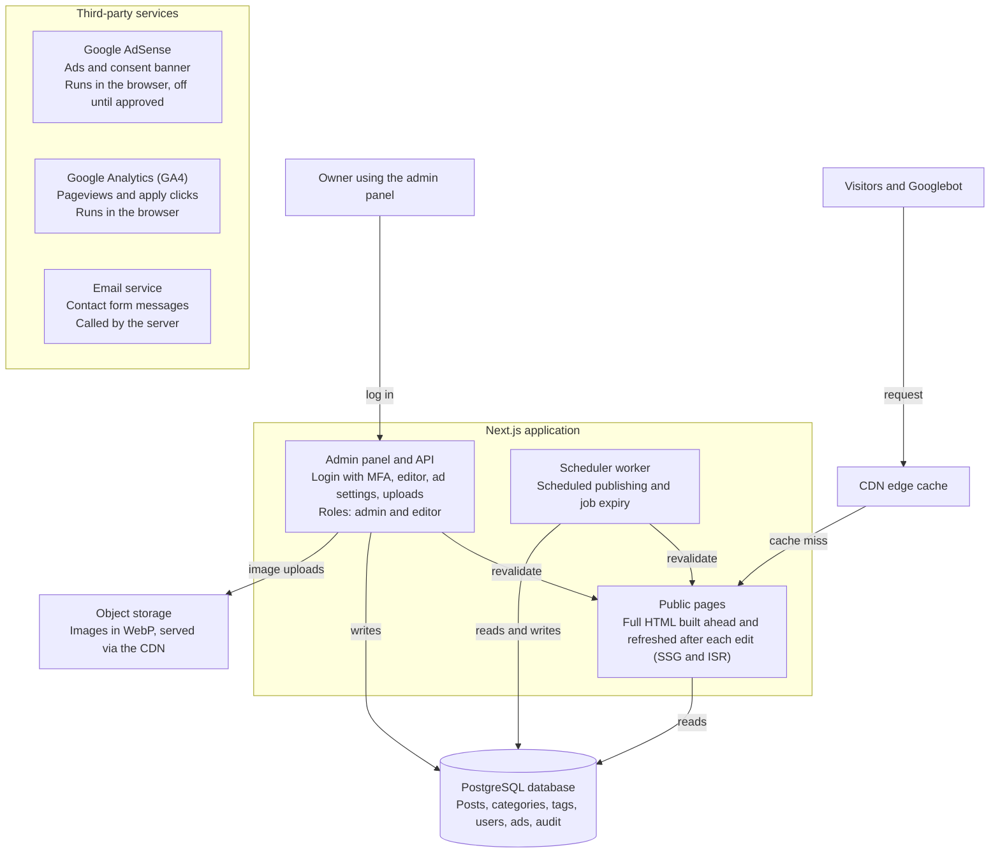
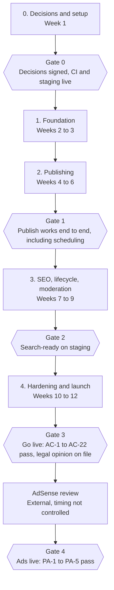

# SRS: Job Posting & Ad Monetization Website

## Document control

- **Document:** Software Requirements Specification, Job Posting & Ad Monetization Website
- **Version:** 1.2 (review-resolution revision)
- **Revision date:** 15 October 2026
- **Status:** Candidate implementation baseline. It becomes the baseline when the owner signs off Appendix B and Gate 0 passes.
- **Supersedes:** Version 1.1. Scope and intent of the original SRS are preserved except where the review below required a change.

### Revision summary (review findings and where they are resolved)

| Review item | Resolution in v1.2 | Where |
| --- | --- | --- |
| B1: schedule not re-baselined | New 12-week baseline with a decision phase, release scope rule (Must and Should in release 1, Could deferred to 1.1), and a cut order | 1.5, 10 |
| B2: ads cannot be tested before AdSense approval | `ads_mode` setting (off, placeholder, live), placeholder-mode tests before launch, and a separate post-approval checklist | AD-14, 10.2, 10.3 |
| B3: new requirements untraceable; criteria 3 and 6 inconsistent | Every requirement has an ID; criteria rewritten; full traceability matrix | 7, 9, 10.1, 10.4 |
| B4: data model does not support its own rules | Added job status, verification fields, post status values, global publisher ID, shared slug namespace with reserved words | 7 |
| B5: platform choices change requirements | Platform selection criteria and environments added; CSP rollout defined | 3.2, 3.3, NFR-7 |
| B6: legal exposure not covered | Legal review requirements and a launch gate | 9.3, Gate 3 |
| S1 to S8: SEO-1/2, FR-28, SEO-27, SEO-26, FR-14, environments, FR-33 | Applied as described in the cited requirements | SEO-1, SEO-2, FR-28, SEO-27, SEO-26, FR-14, 3.2, FR-33 |

## 1. Introduction

This document specifies a job and content publishing website, built with Next.js, that earns revenue from display ads and is designed from the first line of code to rank in Google search.

### 1.1 Purpose

It gives the developer, the site owner, and any future contributor one agreed description of what the site must do, so the build can be estimated, tested, and accepted against it.

### 1.2 Scope

The system is a public website where visitors browse and search job posts and articles, plus a private admin panel where the owner creates, edits, and publishes them. Revenue comes from Google AdSense placements. Employer self-service accounts, paid listings, and a mobile app are out of scope for version 1 and listed as future work.

### 1.3 Definitions

| Term | Meaning |
| --- | --- |
| SRS | Software Requirements Specification, this document |
| SSR / SSG / ISR | Server-side rendering, static generation, and incremental static regeneration: ways Next.js produces full HTML before it reaches the browser |
| CMS | Content management system: the admin panel and database where posts are written |
| JobPosting schema | Structured data (JSON-LD) that tells Google a page describes a job |
| Core Web Vitals | Google's page-experience metrics: LCP (loading), INP (responsiveness), CLS (layout shift) |
| Lab data / field data | Lab data comes from a controlled test run (Lighthouse). Field data comes from real visitors (Search Console) and appears only after a site has traffic |
| Slug | The readable part of a URL, such as `welder-jobs-in-italy` |
| AdSense | Google's program for showing ads on a site and paying the owner |
| CSP | Content Security Policy: a browser rule listing which scripts and resources a page may load |
| CMP | Consent management platform: the banner and records that handle visitor consent |
| Gate | A go or no-go checkpoint in the release plan (Section 10) |

### 1.4 References

- Google Search Central: SEO starter guide and JobPosting structured data documentation
- Google AdSense program policies
- Next.js documentation (App Router, Metadata API, ISR)
- web.dev: Core Web Vitals

### 1.5 Release scope and change control

- **Release 1 (launch):** all requirements with priority Must (M) or Should (S).
- **Release 1.1 (after launch):** all requirements with priority Could (C): FR-13, FR-35, FR-36 (with the `PostRevision` entity), SEO-32, and AD-13.
- **Cut order if the schedule slips:** Should items are removed first, in this order: FR-24, FR-20, FR-23, SEO-33, SEO-31, FR-12. Must items are never cut without a written change to this document.
- **Change control:** any change to a requirement ID, priority, or acceptance criterion is recorded in the revision summary and the decision log (Appendix A).

## 2. Overall description

The site is a self-contained web application with one owner-operated admin and an anonymous public audience that arrives mostly from Google.

### 2.1 Product perspective

Visitors search Google for phrases such as "welder jobs in Italy", land on a post page, read it, and see ads. The owner publishes several new posts a day from the admin panel. Nothing depends on a third-party CMS, but the design keeps the content layer replaceable.

### 2.2 User classes

| User | Goal | Access |
| --- | --- | --- |
| Visitor | Find a relevant job or article quickly and read it | Public pages, no account |
| Search crawler | Read complete HTML, metadata, and structured data | Public pages, sitemap, robots.txt |
| Admin (owner) | Publish and manage posts, categories, ads, and pages | Private admin panel, login with MFA |
| Editor (optional) | Write and edit posts but not change settings or ads | Admin panel, limited role |

### 2.3 Operating environment

- Modern browsers on desktop and mobile; mobile-first, since most job seekers browse on phones
- Node.js runtime on a managed host (Vercel or a VPS), PostgreSQL database
- Works on slow connections: a post page must be readable with ad scripts blocked or delayed

### 2.4 Constraints

- Must follow Google AdSense program policies and Google Search quality guidelines
- Rendered HTML must contain all post content, so no content is loaded only by client-side JavaScript
- Single developer and a small budget: prefer managed services and open-source libraries
- The hosting plan must permit commercial, ad-funded use (see PLT-1)

### 2.5 Assumptions

- Content is written or curated by the owner; the site does not scrape other sites.
- Version 1 serves a single language (English); the data model leaves room for more.
- The owner will apply for AdSense after the site is live with original content. Approval, its timing, and search rankings are external outcomes and are not guaranteed by this specification.
- Until AdSense approves the site, production runs with ads off (AD-14). Ad layout is tested on staging with placeholders.
- All scheduled timestamps are stored in UTC. The admin UI displays and accepts times in the configured site timezone, which must be explicitly configured before launch.
- Only one production deployment and one canonical public hostname are used for version 1.
- AdSense publisher and slot identifiers are configuration values. Arbitrary executable JavaScript is not accepted from the admin UI.
- The application uses a durable scheduling mechanism supported by the chosen host or a managed job service. The provider is an architecture decision recorded at Gate 0.
- Publishing overseas job listings may be regulated in the owner's jurisdiction and in the countries the listings target. This SRS does not provide legal advice; see Section 9.3.

## 3. System architecture and technology stack

One Next.js application serves public pages and hosts the admin panel, with PostgreSQL for content and object storage for images. CDN caching and static or ISR rendering are applied where compatible with page freshness and access-control requirements; private admin and preview responses must never be publicly cached.

Public visitors and Googlebot receive rendered public pages; public requests may invoke server-side reads on cache misses or dynamic routes depending on the chosen Next.js rendering strategy. Protected database operations remain behind the application server. A successful publish triggers revalidation of affected pages and related indexes.

### 3.1 Proposed technology stack

| Layer | Choice | Reason |
| --- | --- | --- |
| Framework | Next.js (App Router) with TypeScript | Server rendering, built-in Metadata API, sitemap and robots support, image optimization |
| Database | PostgreSQL with Prisma or Drizzle ORM | Relational data, full-text search, safe parameterized queries |
| Authentication | A maintained authentication solution (Auth.js or an alternative) that meets PLT-3 | Server-side sessions or equivalent revocation, MFA, server-side authorization on every protected operation |
| Editor | Tiptap rich-text editor | Clean HTML output, headings and tables, easy to restrict to safe tags |
| Styling | Tailwind CSS | Small CSS output and fast mobile-first layouts |
| Images | `next/image` with S3-compatible storage | WebP or AVIF output, responsive sizes, CDN delivery |
| Hosting | A paid Vercel plan, or a VPS with Nginx and PM2, subject to PLT-1 | Vercel gives CDN and ISR with little setup; a VPS costs less at scale |
| Search | PostgreSQL full-text search first | No extra service for version 1; can move to Meilisearch or Algolia later |
| Email | SMTP or a transactional email service | Delivers contact form messages and owner notifications |
| Scheduling | Durable scheduler or job queue with retry and idempotency handling (PLT-2) | Reliable scheduled publishing and expiry processing |
| Consent | A Google-certified CMP | Required for ads and analytics in regulated regions |
| Monitoring | Error tracker and an uptime monitor | Meets NFR-3 and NFR-12 |

### 3.2 Environments and delivery

| ID | Requirement | Priority |
| --- | --- | --- |
| ENV-1 | Three environments exist: local development, staging, and production. Each has its own database, object storage bucket, and secrets. | M |
| ENV-2 | Staging is protected by authentication, emits `noindex`, and runs with `ads_mode` set to `placeholder`. Preview deployments are protected the same way. | M |
| ENV-3 | A CI pipeline runs type checks, linting, automated tests, and a production build on every push. Production deploys only from the main branch after the pipeline passes and the owner approves. | M |
| ENV-4 | A seed script creates sample categories, tags, and clearly labeled fake posts for local and staging use. It never runs against production. | S |
| ENV-5 | Database migrations are version-controlled, applied to staging before production, and documented with a rollback or restore step. | M |
| ENV-6 | Secrets and environment variables are managed per environment and are never committed to the repository. | M |

### 3.3 Platform selection criteria

The platform ADR (ADR-SRS-09) is decided at Gate 0 against these criteria. Each provider's current terms and features must be checked at decision time.

| ID | Criterion | Priority |
| --- | --- | --- |
| PLT-1 | The hosting plan's terms allow commercial, ad-funded sites. Free or hobby tiers that restrict commercial use are not acceptable for production. | M |
| PLT-2 | The scheduler runs at the frequency needed for scheduled publishing (at most 5 minutes late) and expiry checks, supports retries, and can alert on failure. | M |
| PLT-3 | The authentication solution supports TOTP-based MFA and server-side session revocation. If its default session model cannot be revoked, a revocation mechanism (for example a per-user session version checked on each request) is added. | M |
| PLT-4 | The platform supports on-demand revalidation of pages after a publish or edit, and cache rules that never cache private responses. | M |
| PLT-5 | The platform can serve the CSP header defined in NFR-7 and the ads, analytics, and CMP domains listed there. | M |

## 4. Functional requirements

The system must let visitors find and read posts, and let the owner publish them, in 36 numbered functional requirements. Priority uses MoSCoW: M = must have for launch, S = should have, C = could have, deferred to release 1.1 (Section 1.5).

### 4.1 Public website

| ID | Requirement | Priority |
| --- | --- | --- |
| FR-1 | Home page shows a search box, country and job-type filters, and the latest posts as cards (image, title, category, 2-line excerpt) | M |
| FR-2 | Post page shows title, featured image, publish and update dates, category, tags, full body, and an Apply or Source link | M |
| FR-3 | Category pages (for example a country) list posts newest first with pagination of 12 posts per page | M |
| FR-4 | Tag pages (for example a job type) list posts with the same layout as category pages | M |
| FR-5 | Keyword search over title, excerpt, and body returns results in under 1 second | M |
| FR-6 | Filters combine: country, job type, and sort by newest | S |
| FR-7 | Every post shows 4 to 6 related posts chosen by shared category and tags | M |
| FR-8 | Breadcrumb navigation on post, category, and tag pages | M |
| FR-9 | Static pages: About, Contact, Privacy Policy, Terms, Disclaimer | M |
| FR-10 | Contact form with spam protection, delivering to the owner's email | M |
| FR-11 | Custom 404 page that offers search and links to popular categories | S |
| FR-12 | Share buttons (WhatsApp, Facebook, copy link) on post pages | S |
| FR-13 | Email newsletter sign-up for new posts (release 1.1) | C |

### 4.2 Admin panel

| ID | Requirement | Priority |
| --- | --- | --- |
| FR-14 | Secure login for the admin with email, password, and MFA as required by NFR-8; session expires after inactivity and can be revoked | M |
| FR-15 | Create, edit, duplicate, and delete posts | M |
| FR-16 | Post status follows LC-1 (draft, scheduled, published, unpublished, archived). Scheduled posts are never publicly accessible before their scheduled time. Scheduling uses UTC storage, a configured site timezone in the UI, durable execution, idempotent processing, retry and error logging, and recovery after temporary downtime. | M |
| FR-17 | Rich text editor with headings, lists, tables, links, and inline images | M |
| FR-18 | Image upload with automatic resize and WebP conversion; alt text required | M |
| FR-19 | Per-post SEO fields: slug, meta title, meta description, canonical URL, noindex toggle, Open Graph image | M |
| FR-20 | Live search-snippet preview and character counters for meta title and description | S |
| FR-21 | Per-post job fields: employer name, location, salary range, employment type, closing date, application link | M |
| FR-22 | Category and tag management: create, rename, merge, and set a description for each | M |
| FR-23 | Draft preview link that works for the admin before publishing, following SEC-2 | S |
| FR-24 | Bulk actions: publish, unpublish, change category, delete | S |
| FR-25 | Ad settings screen: enable or disable each ad slot and configure approved slot ID, placement, device targeting, and dimensions; the AdSense publisher ID and `ads_mode` are site-wide settings. The admin UI must not accept or execute arbitrary administrator-supplied JavaScript. | M |
| FR-26 | Edit static pages and site settings (site name, logo, social links, default meta description, site timezone, expired-job policy) | M |
| FR-27 | Post list with filters for status, category, and date, plus a title search | M |
| FR-28 | Automatic expiry: when a job's closing date passes, its job status becomes `EXPIRED` within one day; the owner can also mark a job `FILLED` at any time. Expiry processing is idempotent and monitored. The page must stop presenting the job as open and must update or remove `JobPosting` structured data. The owner's expired-job policy (LC-10) decides whether the page stays, is archived, or is removed. | M |

### 4.3 Roles and access

| ID | Requirement | Priority |
| --- | --- | --- |
| FR-29 | Role Admin: full access, including settings, ads, users | M |
| FR-30 | Role Editor: create and edit posts and media, cannot change settings or ads | S |
| FR-31 | Admin pages and protected API operations require a valid session and server-side role authorization. `robots.txt` may discourage crawling but is not a security control. Private routes and data must remain inaccessible without authorization. | M |

### 4.4 Content workflow

| ID | Requirement | Priority |
| --- | --- | --- |
| FR-32 | Post template pre-fills the standard sections (overview, requirements, how to apply, scam warning) | S |
| FR-33 | A mandatory source or official apply link field; a post cannot be published without it. The system validates the URL format, rejects dangerous schemes (normally only HTTPS is accepted, HTTP only by explicit policy), and warns when the link does not respond. Because software cannot confirm that a link leads to a genuine employer, the editor must tick an attestation that the destination is an employer careers page, an official government portal, or a named recruiter's public page, and the attestation date and user are stored. | M |
| FR-34 | Scam-warning notice is added to every job post automatically | M |
| FR-35 | Bulk import of posts from CSV (release 1.1) | C |
| FR-36 | Revision history: the last 10 saved versions of each post can be restored (release 1.1) | C |

## 5. SEO requirements

Every public page must reach Google as complete, fast, uniquely titled HTML with correct structured data, because search traffic is the site's only real source of ad revenue. These requirements are mandatory for launch unless marked otherwise.

### 5.1 Rendering and crawlability

| ID | Requirement | How it is checked |
| --- | --- | --- |
| SEO-1 | All public pages are rendered on the server (SSR, SSG, or ISR, as suits each page type), so the first HTML response contains the full title, body, links, and metadata | View-source shows the post text; Search Console URL Inspection shows the rendered page matches |
| SEO-2 | A publish or edit triggers on-demand revalidation of the affected pages, and the change is visible within 60 seconds of a successful save. Time-based revalidation runs as a safety net only. | Edit a post, reload within a minute |
| SEO-3 | `robots.txt` allows public pages and does not block public internal-search URLs that need to expose a `noindex` directive to crawlers. It may disallow crawling of non-public admin and API paths as a crawl-management measure, but access control is enforced by authentication and authorization, not by `robots.txt`. No secrets or private data may be exposed in those paths. | File review and access-control tests |
| SEO-4 | An XML sitemap is generated automatically and lists posts, categories, tags, and static pages with accurate `lastmod` dates; split into several files by type. Scheduled, unpublished, archived, deleted, and `noindex` pages are excluded. | Sitemap validates in Search Console |
| SEO-5 | The whole site is served over HTTPS; HTTP and the non-preferred host redirect with a 301 to one canonical host | Curl each variant |
| SEO-6 | Navigation, category lists, and pagination use real `<a href>` links, never click handlers alone | Crawl with a link checker |
| SEO-7 | Changing a post's slug automatically creates a 301 redirect from the old URL, subject to DM-6 | Change a slug, request the old URL |

### 5.2 URL structure

| ID | Requirement | How it is checked |
| --- | --- | --- |
| SEO-8 | Post URLs are flat and readable, for example `/welder-jobs-in-italy/`; categories use `/category/italy/` and tags `/tag/welder/` | URL review |
| SEO-9 | Slugs are lowercase, hyphen-separated, free of IDs and dates, and no longer than 75 characters; reserved words and collisions are rejected (DM-5) | Admin form validation |
| SEO-10 | Each page has exactly one canonical URL, set with a self-referencing canonical tag; trailing-slash style is consistent | Crawl report |

### 5.3 On-page metadata

| ID | Requirement | How it is checked |
| --- | --- | --- |
| SEO-11 | Every page has a unique meta title of at most 60 characters and a unique meta description of 140 to 160 characters; the admin panel warns on duplicates and overruns | Crawl report for duplicates |
| SEO-12 | Each page has exactly one H1, and headings run H1 > H2 > H3 without skipping levels | Crawl report |
| SEO-13 | Open Graph and Twitter card tags are present, with a 1200 x 630 image | Social card debugger |
| SEO-14 | Every image has descriptive alt text and explicit width and height | Admin validation, Lighthouse |
| SEO-15 | Internal search-result pages and thank-you pages return an appropriate `noindex` directive and are excluded from the XML sitemap. Crawlers must be able to fetch public search-result URLs to read that directive. Admin pages require authentication and must not expose private content; they may also emit `noindex` as defense in depth. Paginated category and tag pages use consistent canonical and indexation rules; pages 2 onward are indexable with self-referencing canonicals only when they contain useful, crawlable listing content. | Meta tag and crawl review |

### 5.4 Structured data (JSON-LD)

| ID | Requirement | How it is checked |
| --- | --- | --- |
| SEO-16 | Only posts whose `content_type` is `JOB` and whose required job data is valid output `JobPosting` markup. Markup includes applicable properties such as title, description, `datePosted`, `validThrough` when known, hiring organization, job location, employment type, and salary when known. The markup must conform to current Google requirements and must not be emitted for articles or invalid or ineligible jobs. | Google Rich Results Test and page-to-markup comparison |
| SEO-17 | `JobPosting` values match the visible page. When a job closes, the page must no longer represent it as an open vacancy; its structured data is updated or removed according to LC-10 and current Google guidance. A past closing date must not be extended or fabricated. | Manual spot checks and lifecycle tests |
| SEO-18 | Only posts whose `content_type` is `ARTICLE` output `Article` markup with headline, image, author, and dates. Job pages must not receive Article markup as their primary schema. | Rich Results Test and page-to-markup comparison |
| SEO-19 | `BreadcrumbList` markup appears on post, category, and tag pages; `Organization` markup appears on the home page | Rich Results Test |

### 5.5 Performance and Core Web Vitals

| ID | Requirement | How it is checked |
| --- | --- | --- |
| SEO-20 | Before launch, lab targets on mobile for post and list pages: LCP of 2.5 s or less, CLS of 0.1 or less, and total blocking time of 200 ms or less as the lab stand-in for INP. After launch, once Search Console has enough data (typically several weeks), field targets at the 75th percentile: LCP 2.5 s or less, INP 200 ms or less, CLS 0.1 or less. | Lighthouse on staging; later Search Console Core Web Vitals report |
| SEO-21 | Images are served through `next/image` in WebP or AVIF with responsive sizes; only the top image loads eagerly | Lighthouse |
| SEO-22 | Each enabled ad placement defines a responsive reserved-size or minimum-size policy before the ad request, and ad loading must minimize layout shift. Ad scripts must not delay primary content rendering. CLS is measured with ads in placeholder mode (before launch), then with real ads enabled and blocked (after approval). A failed or blocked ad follows AD-9 without causing a late layout jump. | CLS measurement in each ads mode |
| SEO-23 | Fonts are self-hosted with `font-display: swap`; no render-blocking third-party scripts | Lighthouse |
| SEO-24 | Static assets and pages are served from a CDN with long-lived cache headers; private responses are never cached | Response header review |

### 5.6 Internal linking and content quality

| ID | Requirement | How it is checked |
| --- | --- | --- |
| SEO-25 | Every post links to its category and to related posts, and every post is reachable within 3 clicks of the home page | Crawl depth report |
| SEO-26 | Each country and job-type page has a unique intro of at least 150 words, shown on page 1 only, so hub pages are not thin or duplicated. Tag pages carry `noindex` until they have at least 5 published posts (configurable); category pages are indexable. | Admin form requires it; meta tag review |
| SEO-27 | Posts under 400 words show a warning and need the owner's confirmation to publish; this is a quality warning, not a hard block. The admin panel also flags near-duplicate text against existing posts as a warning. | Admin validation |
| SEO-28 | Each post shows a visible published date and a last-updated date | Page review |

### 5.7 Search operations

| ID | Requirement | Priority |
| --- | --- | --- |
| SEO-29 | Site is verified in Google Search Console and Bing Webmaster Tools, and the sitemap is submitted | Must |
| SEO-30 | Analytics (GA4) is installed behind the consent platform, tracking pageviews, search terms, and outbound apply clicks | Must |
| SEO-31 | An RSS feed of the latest posts is published | Should |
| SEO-32 | On publish, the site pings IndexNow so Bing and similar engines learn of new URLs quickly (release 1.1) | Could |
| SEO-33 | A redirect and 404 report in the admin panel lists broken URLs hit by visitors and crawlers | Should |

## 6. Ad monetization requirements

Ads must earn money without slowing pages, shifting the layout, or breaking AdSense policy, and the owner must be able to control every placement from the admin panel without touching code. Because AdSense approval comes after launch, ads run in three modes (AD-14) and are tested in stages.

### 6.1 Ad slots

| Slot | Where it appears | Notes |
| --- | --- | --- |
| Header banner | Below the navigation on every content page | Responsive display unit; the only ad allowed above the first paragraph on mobile |
| In-article 1 | After the first paragraph of a post | Reserved size; starts after content has loaded |
| In-article 2 | Between the middle sections of posts over 800 words | Skipped on shorter posts |
| End of post | After the body, before related posts | Highest viewability slot at the end of reading |
| Sidebar | Desktop only, beside the post body | Sticky within the content column |
| In-feed | After every 6th card on home, category, and tag lists | Styled to match cards but labeled as an ad |
| Auto ads (optional) | Anchor and full-screen interstitial formats | Off by default; each format has its own toggle |

### 6.2 Requirements

| ID | Requirement | Priority |
| --- | --- | --- |
| AD-1 | Each slot is a reusable component whose approved slot ID, placement, dimensions, device rules, and enabled state are configured in the admin panel; the publisher ID is a single site-wide setting. Only validated configuration is rendered; arbitrary user-supplied executable scripts are prohibited. | Must |
| AD-2 | Each slot reserves an appropriate responsive size before ad loading to minimize layout shift. The implementation must not promise zero shift under all third-party conditions; it must meet the agreed CLS target in the defined test environment. | Must |
| AD-3 | Slots below the first screen load lazily when they near the viewport | Must |
| AD-4 | Visitors in the EEA, UK, and Switzerland see a Google-certified consent banner, and ad and analytics scripts load only after consent where the law requires it | Must |
| AD-5 | The site serves `ads.txt` at its root containing the owner's publisher ID | Must |
| AD-6 | Each ad is labeled "Advertisement" and never styled to look like navigation, content, or a download button | Must |
| AD-7 | No ads on pages with little or no content: 404, contact, thank-you, internal search results, and login | Must |
| AD-8 | Admin sessions never load ads, so the owner cannot generate invalid clicks on their own site | Must |
| AD-9 | If an ad fails or is blocked, the slot follows a defined fallback policy: collapse only when doing so will not create a significant late layout shift, or retain a stable reserved region where layout stability requires it. The page must remain usable and must not show a misleading ad placeholder. Test both outcomes on mobile and desktop. | Must |
| AD-10 | The page remains fully readable and navigable with all ad scripts disabled | Must |
| AD-11 | Content stays dominant: on a mobile screen, ads never take more space than the content visible beside them | Should |
| AD-12 | A per-page option disables ads on a given post, for posts that fall outside ad policies | Should |
| AD-13 | The admin dashboard links to the AdSense report and shows page views per post from analytics, so the owner can see which posts earn (release 1.1) | Could |
| AD-14 | A site-wide `ads_mode` setting has three values. `off`: no ad code or placeholders render (the production default until approval; any AdSense site-verification snippet that AdSense requires is allowed). `placeholder`: labeled, empty regions of the real reserved sizes render so layout and CLS can be tested; allowed on staging only and blocked in production. `live`: real ads render; switching to it requires the publisher ID and `ads.txt` to be configured. | Must |

## 7. Data model

The database (PostgreSQL) stores content, users, media, SEO settings, advertising configuration, redirects, moderation reports, and audit events. A post belongs to one category and has many tags. Each post has an explicit content type so job-specific and article-specific validation and structured data cannot be confused.

| Entity | Key fields | Relationships |
| --- | --- | --- |
| Post | `id`, `content_type` (`JOB` or `ARTICLE`), `title`, `slug` (unique, shared namespace with Page), `excerpt`, `body`, `status` (`DRAFT`, `SCHEDULED`, `PUBLISHED`, `UNPUBLISHED`, `ARCHIVED`), `scheduled_at`, `published_at`, `updated_at`, `author_id`, `category_id`, `featured_media_id`, `meta_title`, `meta_description`, `canonical_url`, `noindex`, `ads_enabled`, `deleted_at` | Belongs to one Category and one author (User); has many Tags through `PostTag`; may have one featured Media; has one `JobDetails` when `content_type` is `JOB` |
| JobDetails | `post_id` (unique), `employer_name`, `location`, `country`, `workplace_type`, `employment_type`, `salary_min`, `salary_max`, `salary_currency`, `salary_period`, `closing_date`, `job_status` (`OPEN`, `EXPIRED`, `FILLED`), `job_status_changed_at`, `application_url`, `source_url`, `link_attested_by`, `link_attested_at`, `verification_status` (`NONE`, `VERIFIED`), `verified_at`, `verified_by`, `verification_note` | One-to-one with a JOB post; required fields are validated before publishing (DM-2) |
| Category | `id`, `name`, `slug` (unique), `description` (intro text), `meta_title`, `meta_description` | Has many Posts |
| Tag | `id`, `name`, `slug` (unique), `description` | Many-to-many with Posts |
| PostTag | `post_id`, `tag_id` | Join entity for the Post and Tag relationship; composite unique key |
| Media | `id`, `url`, `alt_text`, `width`, `height`, `mime_type`, `size_bytes`, `uploaded_by` | Used by Posts and Pages |
| User | `id`, `name`, `email` (unique), `password_hash`, `role` (admin or editor), `mfa_enabled`, `session_version`, `last_login_at` | Authors Posts; `session_version` supports session revocation (PLT-3) |
| Page | `id`, `title`, `slug` (unique, shared namespace with Post), `body`, `meta_title`, `meta_description`, `status` | Standalone: About, Contact, Privacy, Terms, Disclaimer |
| AdSlot | `id`, `key` (for example header or in-article-1), `enabled`, `slot_id`, `placement`, `sizes` (allowlisted responsive sizes), `min_height`, `device` (all, mobile, desktop) | Referenced by page templates; stores no publisher ID and no executable code |
| Redirect | `id`, `from_path` (unique), `to_path`, `status_code`, `created_at` | Created on slug change under DM-6 |
| Setting | `key`, `value` (site name, logo, social links, default meta description, analytics ID, AdSense publisher ID, `ads_mode`, site timezone, expired-job policy, tag index threshold) | Single site-wide set |
| JobReport | `id`, `post_id`, `reporter_note`, `status`, `created_at`, `reviewed_at`, `reviewed_by` | Stores listing reports and moderation outcomes |
| AuditLog | `id`, `actor_id`, `action`, `entity_type`, `entity_id`, `metadata`, `created_at` | Records sensitive administrative actions; metadata never contains passwords or secrets |
| PostRevision (release 1.1) | `id`, `post_id`, `revision_number`, `snapshot`, `created_by`, `created_at` | Supports revision history (FR-36) |

Indexes: unique on every slug; on Post (`status`, `published_at`), `scheduled_at`, and on JobDetails (`job_status`, `closing_date`); and a full-text index on Post title, excerpt, and body for search. Add indexes on foreign keys and on report lookups as appropriate.

### 7.1 Data requirements and validation

| ID | Requirement |
| --- | --- |
| DM-1 | `content_type` is mandatory and is either `JOB` or `ARTICLE`. |
| DM-2 | A `JOB` post needs a validated source URL and application URL, employer information, and enough location and employment detail for the listing. Salary is optional when not reliably known; when supplied, minimum and maximum are non-negative, maximum is not lower than minimum, and currency and pay period are explicit. |
| DM-3 | An `ARTICLE` post is never forced to supply job-only fields. |
| DM-4 | `scheduled_at`, `published_at`, `updated_at`, `closing_date`, and audit timestamps have defined timezone semantics. Timestamps are stored in UTC and displayed in the configured site timezone. |
| DM-5 | Post and Page slugs share one namespace and are unique across both, compared case-insensitively. Reserved words are rejected, at least: `admin`, `api`, `category`, `tag`, `search`, `sitemap`, `robots`, `feed`, `ads`, `login`, and the framework's internal path prefixes. |
| DM-6 | A 301 redirect is created on slug change only after the destination is validated, with a check against self-redirects and loops. |
| DM-7 | Rich text is stored in a controlled representation and sanitized on the server before rendering. Editor output is not treated as trusted input. |
| DM-8 | Database migrations are version-controlled and applied through the documented process in ENV-5. |
| DM-9 | Database constraints enforce valid content types, statuses, job statuses, salary ranges, and relationships. |
| DM-10 | The fields behind CI-3 and FR-33 (`verification_status`, `verified_at`, `verified_by`, `link_attested_by`, `link_attested_at`) are mandatory before a JOB post that shows a "verified" label or any job post is published. |

### 7.2 Content lifecycle rules

| ID | Requirement |
| --- | --- |
| LC-1 | Post status values are `DRAFT`, `SCHEDULED`, `PUBLISHED`, `UNPUBLISHED`, and `ARCHIVED`. Job status (`OPEN`, `EXPIRED`, `FILLED`) is stored separately in `JobDetails`. |
| LC-2 | **Archive:** retain the content and remove it from normal public listings; access to the detail URL follows the configured archive policy. |
| LC-3 | **Unpublish:** remove the content from public access without deleting the record. |
| LC-4 | **Soft delete:** set `deleted_at` and retain the record for a defined recovery period (length approved in Appendix B). |
| LC-5 | **Permanent delete:** restricted to administrators and subject to the retention period and legal requirements. |
| LC-6 | **Redirect:** a 301 is used only when a relevant replacement URL exists. Deleted or expired posts are never redirected to the home page or an unrelated page by default. |
| LC-7 | Public queries never return drafts, scheduled posts whose time has not arrived, unpublished posts, archived content excluded by policy, or deleted content. |
| LC-8 | A scheduled post is not publicly accessible, listed, or in the sitemap before its scheduled time. |
| LC-9 | A publish or edit revalidates the post page and all affected category, tag, home, related-post, feed, and sitemap outputs. The 60-second target in SEO-2 is measured from a successful save and depends on the platform's documented cache behavior (PLT-4). |
| LC-10 | The owner documents an expired-job policy before launch: (a) keep a useful expired page with a clear status and update or remove job structured data, (b) archive it, or (c) remove it and return an appropriate HTTP status. |
| LC-11 | The system never fabricates or extends a closing date or `validThrough` value without a reliable source. |

## 8. Non-functional requirements

The site must be fast, secure, accessible, and easy to keep running by one person. Numeric targets are starting points the owner can change.

| ID | Area | Requirement |
| --- | --- | --- |
| NFR-1 | Performance | Server response (TTFB) under 600 ms for cached pages; Lighthouse mobile performance score of 90 or higher on post and list pages |
| NFR-2 | Scalability | Handles 50,000 page views a day on a CDN-backed setup without manual intervention; the database can move to a larger plan without code changes |
| NFR-3 | Availability | 99.5% monthly uptime target; an uptime monitor alerts the owner by email within 5 minutes of an outage |
| NFR-4 | Backups | Automatic daily database backup kept for 14 days; uploaded media stored in object storage; the restore procedure is documented and tested once before launch (SEC-7) |
| NFR-5 | Security | Passwords hashed with Argon2id or bcrypt using a maintained library; login attempts rate-limited to 5 failed attempts per 15 minutes with account and IP controls; HTTPS everywhere with HSTS; secure, HttpOnly, SameSite session cookies; session revocation and recovery controls |
| NFR-6 | Security | Rich-text input is sanitized against XSS; all database access uses parameterized ORM operations; uploads are limited by validated file content, type, dimensions, and size (images only, 5 MB maximum); source and application URLs reject dangerous schemes; authorization is checked server-side for every protected operation |
| NFR-7 | Security | Standard security headers are set (CSP, X-Frame-Options, Referrer-Policy). The CSP allowlist covers the site's own origins plus the AdSense, consent platform, and GA4 domains. It first runs in report-only mode on staging for 7 days with violations reviewed, and is enforced only once no unexpected violations remain. Secrets live in environment variables, never in the repository. |
| NFR-8 | Security | Multi-factor authentication (TOTP) is required for the owner and admin account; recovery codes and account recovery are protected. MFA for editors is recommended. |
| NFR-9 | Accessibility | Conforms to WCAG 2.1 level AA: keyboard navigation, visible focus, contrast ratio of at least 4.5:1, labeled form fields |
| NFR-10 | Compatibility | Latest two versions of Chrome, Safari, Firefox, and Edge, and Chrome on Android; layouts verified from 360 px width upward |
| NFR-11 | Maintainability | TypeScript throughout, linting and formatting enforced, code in Git with an automated build check on each push (ENV-3) |
| NFR-12 | Monitoring | Application errors and failed scheduled jobs are captured by an error-tracking service; critical alerts notify the owner; dashboards and alerts are reviewed regularly |
| NFR-13 | Localization | All interface text is kept out of components so Urdu or another language can be added later; layouts tolerate right-to-left text |
| NFR-14 | Privacy | Cookie and consent handling follows applicable law; the Privacy Policy lists analytics and ad cookies; contact-form data is kept no longer than 12 months |

## 9. Content integrity, security, and compliance

The site must never help anyone defraud a job seeker, both because overseas-work listings attract scams and because Google and AdSense penalize misleading content. These rules are enforced by the admin panel, not left to memory.

### 9.1 Content integrity

| ID | Requirement |
| --- | --- |
| CI-1 | No post may ask applicants for money, and the site itself never charges applicants or collects documents, ID numbers, or payments |
| CI-2 | Every job post links to the employer's own careers page, an official government portal, or a named recruiter's public page; the admin panel will not publish without that link and the attestation in FR-33 |
| CI-3 | The word "verified" appears on the site only if the owner has a written verification step (for example, confirming the employer's website and contact details) and the verification date and user are recorded on the post (DM-10) |
| CI-4 | Posts never promise a visa, a job, or a salary; wording such as "guaranteed" or "100% visa" is blocked by a word check in the editor |
| CI-5 | Each job post carries a standard notice on how to spot fake offers and on never paying an agent for an interview or a visa (FR-34) |
| CI-6 | A visible "Report this listing" link opens a rate-limited form that stores the post URL, reporter note, timestamp, and moderation status and notifies the owner. Reports are reviewed within 48 hours; unsafe listings are unpublished while under review. The admin panel supports status tracking and records moderation actions. |
| CI-7 | Posts are written in the owner's own words; copied text from other job sites is not allowed, and sources are named |
| CI-8 | Closed or expired jobs are marked as expired within one day of their closing date, or earlier if the employer reports it is filled (FR-28) |
| CI-9 | The footer links to Privacy Policy, Terms, Disclaimer, About, and Contact on every page; the Disclaimer states the site is not a recruitment agency |
| CI-10 | Images and logos are original, licensed, or used with permission; employers' logos are not used without approval |

### 9.2 Security and privacy controls

| ID | Requirement |
| --- | --- |
| SEC-1 | Every protected server action, route handler, and data operation verifies the authenticated user's role and permission. Hiding a UI control is not authorization. |
| SEC-2 | Draft preview links use short-lived, unguessable tokens or authenticated access; previews are excluded from indexing and cannot expose unpublished content through predictable URLs. |
| SEC-3 | Contact and report forms use server-side validation, rate limits, and spam protection. Secrets, password hashes, session tokens, and private reporter information must not appear in logs. |
| SEC-4 | Ad configuration is allowlisted and typed. The application renders only approved integration and configuration values and never executes arbitrary code pasted into the admin panel. |
| SEC-5 | File uploads are checked by content, size, and dimensions; unsafe files are rejected. |
| SEC-6 | Administrative actions that affect users, roles, content publication or deletion, ad configuration, or settings are recorded in the audit log. |
| SEC-7 | Backup restoration covers database data and the configuration needed to reconnect media storage. Secrets are re-provisioned securely rather than embedded in backups or source control. |

### 9.3 Legal and regulatory review

| ID | Requirement | Priority |
| --- | --- | --- |
| LEG-1 | Before launch, the owner obtains a written opinion from qualified counsel on whether publishing overseas job listings requires a licence, registration, or specific disclosures in the owner's jurisdiction and in the countries the listings target. The opinion is kept on file. | M |
| LEG-2 | Counsel's findings are reflected in the Terms, Disclaimer, and listing rules before launch. The "not a recruitment agency" disclaimer alone is not treated as sufficient. | M |
| LEG-3 | If counsel advises against certain listing types or destinations, those categories are removed or restricted before launch and recorded in the decision log. | M |

This SRS is not legal advice; LEG-1 exists so that a qualified professional decides these questions.

## 10. Release plan, acceptance criteria, and traceability

The baseline plan is 12 weeks for one full-time developer, in five phases with four gates before launch, plus a post-launch ads gate. The owner's content writing runs in parallel from week 3. A realistic range is 10 to 14 weeks, depending on how quickly decisions and the legal review are completed.

### 10.1 Phases and gates

| Phase | Weeks | Main work | Exit gate |
| --- | --- | --- | --- |
| 0. Decisions and setup | 1 | Approve Appendix B decisions and the platform ADR (PLT-1 to PLT-5); start the legal review; create the repository, CI pipeline, staging, and environments (ENV-1 to ENV-6) | **Gate 0:** decisions signed, staging deploys from CI |
| 1. Foundation | 2 to 3 | Schema and migrations, authentication with MFA and session revocation, roles, audit log, admin shell | Internal milestone: login with MFA and role checks demonstrated |
| 2. Publishing | 4 to 6 | Rich-text editor, media, categories and tags, post lifecycle and scheduler, public templates, search, contact form | **Gate 1:** AC-1 and AC-2 pass on staging |
| 3. SEO, lifecycle, moderation | 7 to 9 | Metadata, sitemap, redirects, structured data, expiry, report workflow, ad slots in placeholder mode, CMP on staging, CSP in report-only mode, performance tuning | **Gate 2:** AC-3, AC-4, AC-5, AC-6, AC-10 pass on staging |
| 4. Hardening and launch | 10 to 12 | Security review, CSP enforcement, backup restore drill, legal opinion on file, at least 20 original posts and legal pages live, Search Console set up, AdSense application sent | **Gate 3:** AC-1 to AC-22 all pass and the owner signs off |
| Post-launch | After launch | Wait for AdSense review (external); enable `live` ads on staging, then production | **Gate 4:** PA-1 to PA-5 pass |

### 10.2 Pre-launch acceptance criteria

| # | Criterion | How it is tested | Verifies |
| --- | --- | --- | --- |
| AC-1 | An admin can create, edit, preview, and publish a post, and the change appears on the public site within 60 seconds of saving; the post list filters and bulk actions, the snippet preview and character counters, and the site settings screen also work | Walk through with a test post, timed | FR-14, FR-15, FR-17 to FR-24, FR-26, FR-27, SEO-2, LC-9 |
| AC-2 | A scheduled post is invisible before its time and publishes exactly once after it, including after a temporary scheduler interruption; a failed job raises an alert | Scheduler integration test with forced failure and recovery | FR-16, LC-1, LC-8, NFR-12, PLT-2 |
| AC-3 | `JOB` posts emit valid `JobPosting` data and `ARTICLE` posts emit `Article` data, with no wrong or duplicate primary schema, on at least 5 sample posts of each type | Rich Results Test and page-to-markup comparison | SEO-16, SEO-17, SEO-18, SEO-19 |
| AC-4 | View-source on every public page type shows the full title, body, links, and metadata; a crawl report shows unique titles and descriptions, one H1 per page, social card tags, and image alt text; filters and pagination are real links; search returns in under 1 second; the 404 page and share buttons work | Manual check, link crawl, timed search | FR-1 to FR-12, SEO-1, SEO-6, SEO-11 to SEO-14, SEO-25, SEO-28 |
| AC-5 | `sitemap.xml` and `robots.txt` are valid; public search URLs are crawlable and return `noindex`; excluded content is absent from the sitemap; protected routes stay protected regardless of `robots.txt`; the RSS feed validates; the redirect and 404 report lists test broken URLs | Crawl check and direct-access tests | SEO-3, SEO-4, SEO-5, SEO-15, SEO-29, SEO-31, SEO-33, FR-31 |
| AC-6 | On staging with ads in placeholder mode and with ads off, mobile Lighthouse performance is 90 or higher and lab LCP, CLS, and blocking time meet SEO-20 on post and list pages | Lighthouse runs on staging | SEO-20 to SEO-24, NFR-1, NFR-2 |
| AC-7 | Unauthenticated users cannot read drafts, previews, admin data, or protected API responses by direct URL; an editor cannot change settings, ads, or users; rich text containing script content is sanitized on render; unsafe uploads are rejected | Authorization and end-to-end tests | FR-29, FR-30, FR-31, SEC-1, SEC-2, SEC-5, DM-7, NFR-6 |
| AC-8 | Login is rate-limited, MFA is enforced for the admin, sessions expire and can be revoked | Security test | FR-14, NFR-5, NFR-8, PLT-3 |
| AC-9 | Ad settings accept only allowlisted slot configuration; pasted scripts are rejected and never rendered | Input validation and security test | FR-25, AD-1, SEC-4 |
| AC-10 | In placeholder mode on staging: reserved sizes hold, no slot appears on excluded pages, the page works with ad scripts disabled, a collapsed or retained slot follows AD-9 without a late shift beyond the CLS target, and production cannot be set to placeholder | Visual and performance tests on mobile and desktop | AD-2, AD-3, AD-6 to AD-12, AD-14, SEO-22 |
| AC-11 | The consent banner appears in regions that require it, and ad and analytics scripts wait for consent | Test with a browser set to an EEA location on staging | AD-4, SEO-30 |
| AC-12 | Expired, filled, unpublished, archived, and deleted posts follow the HTTP, sitemap, listing, and structured-data rules in LC-2 to LC-11 and the owner's expired-job policy; timestamps are stored in UTC and shown in the site timezone; the database rejects invalid statuses and salary ranges | Lifecycle integration tests | FR-28, SEO-17, SEO-4, CI-8, LC-1 to LC-11, DM-4, DM-9 |
| AC-13 | Slug collisions between posts and pages and reserved words are rejected; a slug change creates a 301 with no loops; URL and canonical rules hold | Admin and crawl tests | SEO-7 to SEO-10, DM-5, DM-6, FR-22 |
| AC-14 | Every job post has a source link, attestation, scam notice, and verification record where "verified" is shown; banned wording is blocked; legal pages appear in the footer; `JOB` posts require job fields while `ARTICLE` posts do not | Content review of all posts and editor tests | FR-32 to FR-34, CI-1 to CI-5, CI-9, CI-10, DM-1 to DM-3, DM-10 |
| AC-15 | Contact and report forms validate input, rate-limit, resist spam, deliver to the owner, and store report status; reports can be tracked through moderation | Form and workflow tests | FR-10, CI-6, SEC-3 |
| AC-16 | A database backup restores into a clean database with media references intact, and the configuration needed to reconnect is recoverable | Restore drill before launch | NFR-4, SEC-7 |
| AC-17 | Audit records are created for sensitive administrative changes and contain no secrets | Audit-log test | SEC-6 |
| AC-18 | The CSP ran in report-only mode on staging for 7 days with no unexpected violations, then was enforced, and ads, consent, and analytics domains work | Report review and enforcement test | NFR-7, PLT-5 |
| AC-19 | Key templates meet WCAG 2.1 AA checks and layouts hold from 360 px width | Automated and manual accessibility checks | NFR-9, NFR-10 |
| AC-20 | CI runs checks and tests on every push; staging is protected and `noindex`; migrations apply cleanly staging first; uptime and error alerts reach the owner; interface text is kept out of components; the chosen hosting plan's terms are confirmed to allow commercial use, on-demand revalidation works, and private responses are not cached | Pipeline and environment review | ENV-1 to ENV-6, PLT-1, PLT-4, DM-8, NFR-3, NFR-11, NFR-12, NFR-13 |
| AC-21 | A written legal opinion is on file and its findings are applied to the Terms, Disclaimer, and listing rules | Document review by the owner | LEG-1, LEG-2, LEG-3 |
| AC-22 | At least 20 original, reviewed posts and all legal pages are live; Search Console and Bing are verified and the sitemap submitted; privacy and consent copy matches the cookies actually used | Content review and checklist | CI-7, SEO-26, SEO-27, SEO-29, NFR-14, FR-9 |

### 10.3 Post-approval acceptance criteria (Gate 4)

| # | Criterion | How it is tested | Verifies |
| --- | --- | --- | --- |
| PA-1 | AdSense has approved the site, and `ads.txt` at the site root contains the correct publisher ID | Check AdSense status and fetch `/ads.txt` | AD-5 |
| PA-2 | With `ads_mode` set to `live` on staging, then production, real ads appear in their slots, are labeled, are absent on excluded pages, and are never loaded in admin sessions | Visual check and admin-session test | AD-1, AD-6, AD-7, AD-8, AD-14 |
| PA-3 | CLS with real ads enabled and with ads blocked is within the agreed target on mobile and desktop | Lighthouse and layout-shift measurement | SEO-22, AD-2, AD-9 |
| PA-4 | The enforced CSP still passes with live ads, and the consent banner still gates ad scripts | Browser console and consent test | NFR-7, AD-4 |
| PA-5 | Field Core Web Vitals in Search Console are reviewed once data is available, and any failing page group has a fix planned | Search Console report | SEO-20 |

### 10.4 Traceability matrix

Every requirement ID maps to a phase and at least one test. Release 1.1 items are listed last.

| Requirement group | IDs | Phase | Verified by |
| --- | --- | --- | --- |
| Public website | FR-1 to FR-12 | 2, 3 | AC-4, AC-14, AC-15 |
| Admin content management | FR-15, FR-17 to FR-27 | 2 | AC-1, AC-9, AC-13 |
| Scheduling and lifecycle | FR-16, FR-28, LC-1 to LC-11 | 2, 3 | AC-2, AC-12 |
| Access and security | FR-14, FR-29 to FR-31, SEC-1 to SEC-7, NFR-5 to NFR-8 | 1, 4 | AC-7, AC-8, AC-16, AC-17, AC-18 |
| Content workflow and integrity | FR-32 to FR-34, CI-1 to CI-10 | 2 to 4 | AC-14, AC-15, AC-22 |
| Legal | LEG-1 to LEG-3 | 0 to 4 | AC-21 |
| SEO rendering and URLs | SEO-1 to SEO-10 | 3 | AC-4, AC-5, AC-13 |
| SEO metadata and structured data | SEO-11 to SEO-19 | 3 | AC-3, AC-4, AC-5 |
| Performance | SEO-20 to SEO-24, NFR-1, NFR-2 | 3, 4 | AC-6, PA-3, PA-5 |
| Linking, content quality, search operations | SEO-25 to SEO-31, SEO-33 | 3, 4 | AC-4, AC-5, AC-11, AC-22 |
| Ads | AD-1 to AD-12, AD-14 | 3, then Gate 4 | AC-9, AC-10, AC-11, PA-1 to PA-4 |
| Data model and validation | DM-1 to DM-10 | 1, 2 | AC-7, AC-12, AC-13, AC-14, AC-20 |
| Environments and platform | ENV-1 to ENV-6, PLT-1 to PLT-5 | 0 | AC-20, AC-18, AC-8 |
| Operations and quality | NFR-3, NFR-4, NFR-9 to NFR-14 | 0, 4 | AC-16, AC-19, AC-20, AC-22 |
| Release 1.1 (deferred) | FR-13, FR-35, FR-36, SEO-32, AD-13, `PostRevision` | After launch | To be specified in the release 1.1 plan |

### 10.5 Schedule risks

| Risk | Effect | Response |
| --- | --- | --- |
| Slow owner decisions (Appendix B) | Gate 0 slips and delays everything after it | Hold a decision meeting in week 1; unresolved items default to the proposal in this document |
| Legal review takes longer than expected | Gate 3 cannot pass | Start in week 1 (Phase 0); launch waits for LEG-1 |
| Content writing falls behind | AC-22 cannot pass | Owner writes from week 3; track post count weekly |
| Scope growth | Plan exceeds 12 weeks | Apply the cut order in Section 1.5 before touching Must items |
| AdSense approval delayed or refused | No ad revenue after launch | External and outside the 12 weeks; improve content and resubmit; the site works without ads |

### 10.6 Out of scope for version 1

- Employer accounts and self-service job posting
- Paid featured listings and payments
- Job alerts and saved jobs
- Urdu or other language versions of the interface
- A mobile app

## Appendix A. Decision log

These are proposed decisions for stakeholder approval unless marked otherwise. Nothing here is evidence that implementation has occurred.

| ID | Decision or clarification | Status |
| --- | --- | --- |
| ADR-SRS-01 | Public search-result URLs must be crawlable when Google needs to read `noindex`; `robots.txt` is not access control. | Proposed |
| ADR-SRS-02 | Every post has an explicit `content_type` (`JOB` or `ARTICLE`) with type-specific validation and schema output. | Proposed |
| ADR-SRS-03 | Admin ad settings use validated slot configuration and never execute arbitrary pasted scripts; the publisher ID is one site-wide setting. | Proposed |
| ADR-SRS-04 | Scheduled timestamps are stored in UTC; the admin UI uses a configured site timezone; scheduler execution is durable, idempotent, retryable, and observable. | Proposed; scheduler provider decided at Gate 0 |
| ADR-SRS-05 | Archive, unpublish, soft delete, permanent delete, and redirect are separate lifecycle operations. | Proposed; retention period to be approved |
| ADR-SRS-06 | Ad-slot fallback preserves readability and minimizes CLS; zero layout shift is not guaranteed by third-party ad delivery. | Proposed; slot sizes to be designed |
| ADR-SRS-07 | Job expiry does not automatically mean deletion or an unconditional redirect; the expired-page policy is approved before launch. | Open owner decision |
| ADR-SRS-08 | Owner and admin MFA is required; editor MFA is recommended. | Proposed; confirmed against PLT-3 at Gate 0 |
| ADR-SRS-09 | Hosting, database hosting, ORM, email, object storage, scheduler, error tracker, CMP, and canonical hostname are chosen at Gate 0 against PLT-1 to PLT-5 and recorded here. | Open; criteria defined in 3.3 |
| ADR-SRS-10 | The 12-week plan is a target for one full-time developer, not a delivery guarantee. | Planning assumption |
| ADR-SRS-11 | Release 1 contains all Must and Should items; all Could items move to release 1.1; Should items are cut first in the stated order. | Proposed |
| ADR-SRS-12 | Ads run in three modes (`off`, `placeholder`, `live`); production stays `off` until AdSense approves; ad layout is tested with placeholders on staging. | Proposed |
| ADR-SRS-13 | Post and Page slugs share one namespace with a reserved-word list. | Proposed |
| ADR-SRS-14 | Launch is blocked until a written legal opinion on overseas job listings is on file. | Proposed |
| ADR-SRS-15 | The CSP is rolled out in report-only mode first and enforced after a clean 7-day staging run. | Proposed |
| ADR-SRS-16 | Pre-launch performance is judged on lab data; field data is reviewed after launch. | Proposed |

## Appendix B. Items requiring owner approval

Before the SRS becomes the approved implementation baseline, the owner decides or confirms:

1. The production domain and preferred hostname.
2. The hosting provider, database hosting, and backup retention and cost, checked against PLT-1 to PLT-5.
3. The site timezone used for scheduled publishing and display.
4. The policy for expired jobs: retained and marked expired, archived, or removed.
5. The soft-delete retention period and who may permanently delete content.
6. The consent platform and the jurisdictions it must cover.
7. The final ad placements, responsive slot sizes, and fallback behavior.
8. That release 1 is all Must and Should items, with Could items deferred to release 1.1 (ADR-SRS-11).
9. The initial content target (at least 20 posts) and the editorial process for checking the accuracy and originality of job listings.
10. The operational owner for monitoring, backup restoration, security incidents, and reports of fraudulent listings.
11. The counsel who will provide the legal opinion in LEG-1, and the target start date for that review.
12. The authentication solution and how it meets PLT-3 (MFA and session revocation).

## Appendix C. Verification status

This revision is a requirements-document update only. No application code was inspected or changed, and no tests, deployments, Google validations, or AdSense checks were executed. All acceptance criteria remain to be verified during development and release testing.
